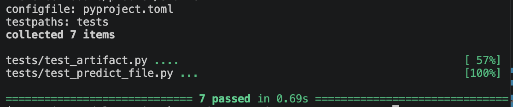

# Starter — Bundle serializado de calidad de vino

## Santi

En starter, ejecutar:

```bash
uv run python -m model_packaging.predict_file \
  --bundle assets/models/wine_quality_bundle \
  --input ../../../../../../../../semana3/assets/03-wine-quality/inference_samples.csv \
  --output .tmp/wine_predictions.csv
```



## Comentarios profesor

Este es el único proyecto de código que recibe el alumnado. Los contratos de
entrada y el orden de las características ya vienen resueltos para que el
taller se concentre en serialización, carga y validación.

Implementad los TODO de src/model_packaging/artifact.py y
src/model_packaging/predict_file.py en el orden indicado por ../readme.md. Las
pruebas de tests/ son la especificación ejecutable.

El artefacto real del profesor, si se usa, debe vivir en
models/wine_quality_bundle/; esa carpeta se ignora y no se entrega dentro del
repositorio del alumnado.
