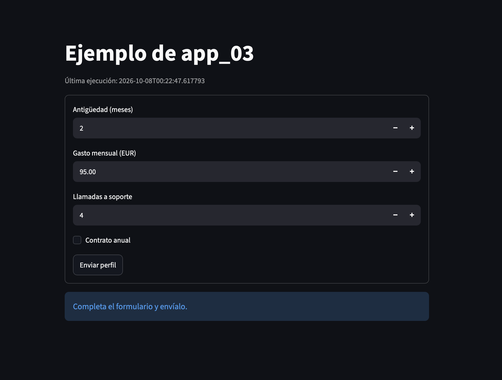

# Streamlit web app demos

This folder contains brief examples of the Python Streamlit library.
`web_st.py` is the main example.

You can run any of the scripts from `app_01.py` to `app_04.py` (and the main
example above). Each demonstrates different Streamlit features, including
widgets such as checkboxes and buttons.

`app_04.py` calls a synthetic churn model in
`demo_streamlit_s5_20261007_200403_272110/model.py`.

## How to run the code

Use the shared Semana 5 environment. Run these commands from the `semana5`
directory:

```bash
uv run --extra app streamlit run "Zip s5 Streamlit/src/s5_streamlit_churn_ejemplos/app_01.py"
```

To run the app that uses the model:

```bash
uv run --extra app streamlit run "Zip s5 Streamlit/src/s5_streamlit_churn_ejemplos/app_04.py"
```

To run the main example:

```bash
uv run --extra app streamlit run "Zip s5 Streamlit/web_st.py"
```

You can modify a script, and Streamlit will show a **Rerun** button to display
your saved changes.

## Why use Streamlit?

Useful for:
- Showing demos
- Visualizing projects
- Avoiding presenting a raw Python script to your boss

[Streamlit website](https://streamlit.io)

Example:



Link for `web_st.py`: [link](https://streamlit-5f5m.onrender.com/)
