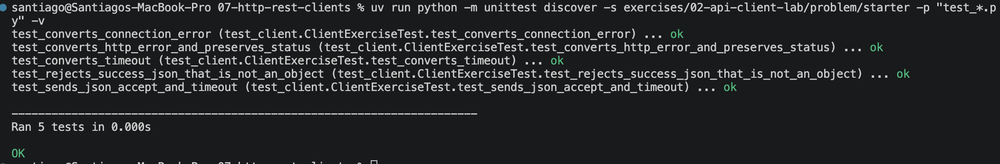

# Ampliación posterior a la clase 1 — consumir una API de predicción

Este laboratorio es una **ampliación posterior a la clase 1** o assignment;
**no es la clase 2**. La clase 2 continúa el proyecto Wine Quality en
[`03-wine-http-gateway`](../../03-wine-http-gateway/README.md).

## Objetivo

Consumir una API local ya preparada con curl y Python. Postman queda como
ampliación opcional. No abras ni modifiques el servidor: el trabajo está en el
lado cliente.

## 0. Arranque y salud

Desde la raíz del módulo:

```text
uv run python examples/pump-maintenance-api/server.py
```

En otra terminal ejecuta el `GET /health` de la [guía curl](../../../examples/curl/README.md).

Command 
```bash
BASE_URL="http://127.0.0.1:8000"
curl -i "$BASE_URL/health"
```
Output
```bash
HTTP/1.1 200 OK
Server: S7LocalAPI/1.0 Python/3.14.7
Date: Tue, 10 Nov 2026 13:14:52 GMT
Content-Type: application/json; charset=utf-8
Content-Length: 153
X-Request-Id: req_177d240e90ad

{"status": "ok", "service": "pump-maintenance-prediction", "model_status": "ready", "model_version": "pump-risk-1.0.0", "request_id": "req_177d240e90ad"}%                                                                                              
```

Command
```bash
curl -i -X POST "$BASE_URL/v1/predictions" \
  -H "Accept: application/json" \
  -H "Content-Type: application/json" \
  --data-binary @examples/pump-maintenance-api/samples/prediction-valid.json
```
Devuelve una respuesta 200 (OK). Output:
```bash
HTTP/1.1 200 OK
Server: S7LocalAPI/1.0 Python/3.14.7
Date: Tue, 10 Nov 2026 13:17:53 GMT
Content-Type: application/json; charset=utf-8
Content-Length: 165
X-Request-Id: req_287525fbec06

{"machine_id": "pump-017", "prediction": {"label": "maintenance_required", "risk_score": 0.85}, "model_version": "pump-risk-1.0.0", "request_id": "req_287525fbec06"}%             
```

Command
```bash
curl -i -X POST "$BASE_URL/v1/predictions" \
  -H "Accept: application/json" \
  -H "Content-Type: application/json" \
  --data-binary @examples/pump-maintenance-api/samples/prediction-invalid.json
```
Ha devuelto un 422. El input es válido, pero no lo puede leer por incumplir el contrato. `measurements.vibration_mm_s` debe ser un número. Output:
```bash
HTTP/1.1 422 Unprocessable Content
Server: S7LocalAPI/1.0 Python/3.14.7
Date: Tue, 10 Nov 2026 13:19:26 GMT
Content-Type: application/json; charset=utf-8
Content-Length: 218
X-Request-Id: req_3133bbf7551a

{"error": {"code": "validation_error", "message": "JSON is valid but violates the input contract", "fields": [{"field": "measurements.vibration_mm_s", "message": "must be a number"}]}, "request_id": "req_3133bbf7551a"}%        
```


**Comprobación:** obtienes `200`, `status: ok`, `model_status: ready` y un
`request_id`.


## 1. Observar el contrato con curl

Ejecuta el POST válido y el inválido ya preparados.

**TODO 1:** registra método, path, `Content-Type`, status, `request_id` y el
campo rechazado. Explica por qué el segundo caso es `422`, no `400`.

Respuesta: El segundo POST ha devuelto un 422 porque, aunque el input es válido, pero no lo puede leer por incumplir el contrato. `measurements.vibration_mm_s` debe ser un número.

El path es `/v1/predictions` y el método es `POST`. Content type es `application/json`. Request_id de la primera petición es `req_287525fbec06`. Request id de la segunda es `req_3133bbf7551a`.

**Comprobación:** no confundas `maintenance_required` con un error HTTP; el
primer status sigue siendo `200`.

## 2. Ampliación opcional con Postman

Completa el [ejercicio Postman](../../../examples/postman/README.md). La
colección sirve para comprobar el resultado, pero reconstruye al menos una
petición manualmente.

**TODO 2 opcional:** prepara una tabla de evidencia con salud, éxito y
validación.

Hecho [aquí](../../../examples/postman/README.md).

## 3. Completar el cliente Python

Trabaja en `starter/client.py` y ejecuta:

```text
uv run python -m unittest discover -s exercises/02-api-client-lab/problem/starter -p "test_*.py" -v
```

Los cinco tests empiezan en rojo por el `NotImplementedError` intencional.

**TODO 3 — petición:** usa `session.post()` con:

- URL terminada en `/v1/predictions`;
- `json=payload`, no `data=str(payload)`;
- `headers={"Accept": "application/json"}`;
- `timeout=timeout`.

Esto es necesario para serializar correctamente el cuerpo, expresar el formato
esperado y limitar la espera. Comprueba que pasa el test de argumentos.

**TODO 4 — status:** llama a `response.raise_for_status()`. Convierte
`requests.HTTPError` en `PredictionClientError` conservando el código. Esto
evita tratar un `422` como una predicción. Comprueba el test de error HTTP.

**TODO 5 — transporte:** captura `requests.Timeout` y
`requests.ConnectionError` antes del error genérico. Devuelve mensajes que
permitan decidir entre reintentar o revisar la URL. Comprueba los tests de
timeout y conexión.

**TODO 6 — respuesta:** usa `response.json()` y rechaza una respuesta de éxito
que no sea un objeto JSON. Comprueba el test de contrato de salida.

## Evidencia final



- cinco tests verdes;
- salida de un `200` y un `422`;
- una frase que explique por qué no conviene reintentar ciegamente un POST;
- ningún cambio en la API de caja negra.
